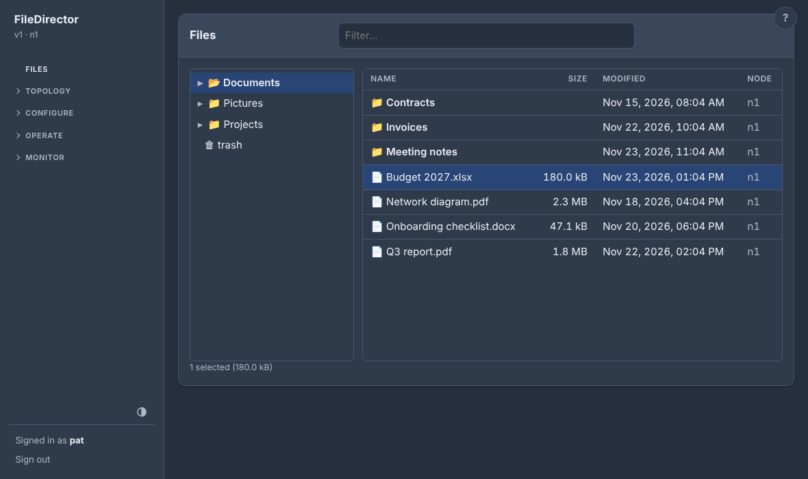
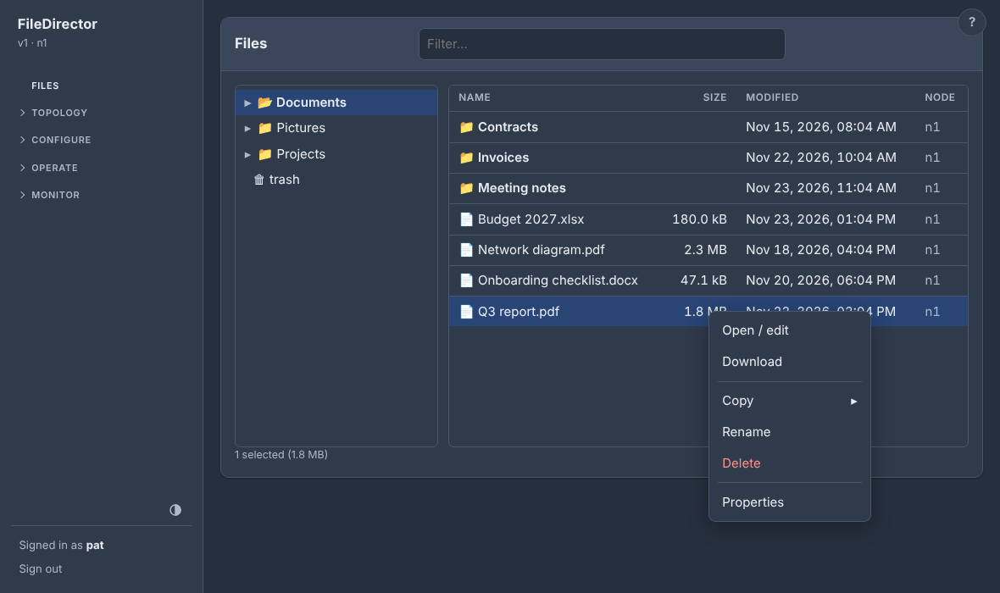
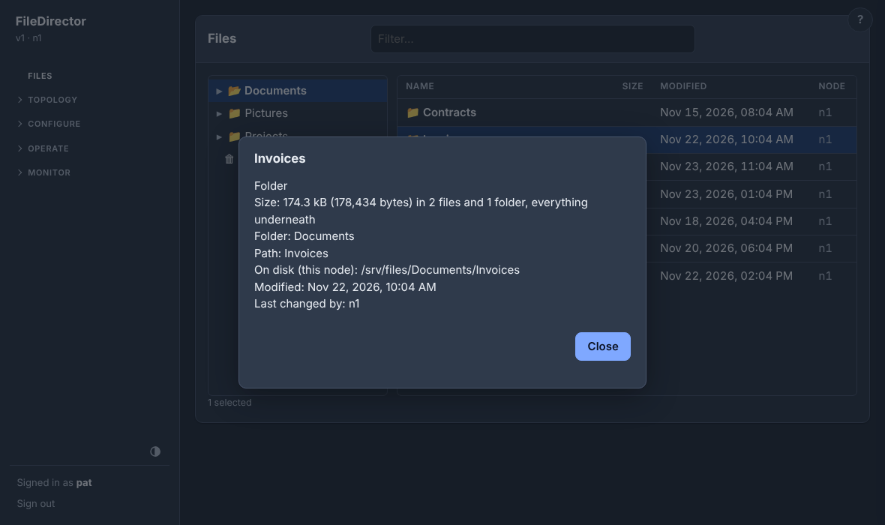
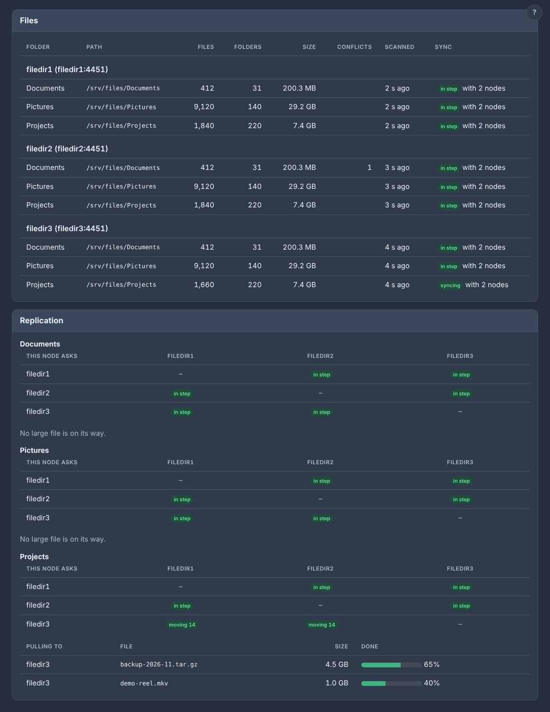

# FileDirector

FileDirector (`filedir`) keeps folders identical on several machines. You pick a folder on one node, give it a name, and every node that has a folder with that name ends up with the same files. Write to any node and the change shows up on the others, usually within about 40 seconds. There is no central copy. If a node is down, it only misses what changed while it was away, and it catches up when it returns.

It is a single Go program that uses nothing outside the standard library. It shares its cluster, shared virtual IP (VIP), web GUI, MCP server and update machinery with its sibling programs flowdir and logdir.



## What you get

**Folders.** Configure ▸ Folders is the list of folders to keep in step. Each has an id, a path on the node, optional ignore patterns, a size limit and a trash retention. The same id on two nodes means the same folder, and the path can differ from node to node.

**Fast transfers between nodes.** A node that needs a file asks every node that has that version for blocks, in parallel, and checks each block's hash as it arrives. If one node fails, it asks another. Big files are shared while they are still on their way: nodes tell each other which blocks they already have and take blocks in different orders, so a new file spreads over all the nodes' uplinks instead of just the first one's. The protocol is our own and does not speak BitTorrent.

**Encryption.** Nodes talk over TLS with pinned certificates, and every request is signed. File traffic has its own port, 4452.

**Conflicts.** Each file carries a version vector. If two nodes change the same file at the same time, a change beats a delete, and otherwise the later modification wins. The loser is kept next to the winner as `name.sync-conflict-DATE-TIME-NODE.ext`, so nothing is lost.

**Safety nets.**
- A folder must contain a `.filedir` marker, so an unmounted disk can't pass for a mass delete.
- A sync that would delete more than half of a folder (and more than 100 files) is refused.
- Replaced and deleted files go to `.filedir/trash`, for 30 days unless you change it.
- Symlinks are never followed out of a folder.
- Synced folders stop accepting files when their disk is 80% full (you can change the limit).

**A file manager in the browser.** The Files page has a folder tree and a list. There are no buttons: everything is in the right-click menu. Click selects, Ctrl+click and Shift+click select several, and the menu then acts on the whole selection. You can drop files and whole folders from your computer onto it to upload them, and download a folder or a selection as a zip. Copy, move and upload show progress in the footer, and a copy can be cancelled. An upload that is cut off carries on where it stopped.



Properties gives a file and a folder the same facts. For a folder, the size is everything underneath it.



**Quick change detection.** A change made on a node's disk is noticed within about a second (inotify), and the other nodes are told right away. A scan every 30 seconds remains as a safety net.

**WebDAV.** The files site also speaks WebDAV at `/dav/`, so you can mount it as a network drive in Windows or Finder, or use it with rclone. It uses the same sign-in and groups as the Files page.

**The files site.** People who only need their files get the Files page and nothing else, on the gateways' addresses (the VIPs and anycast addresses) at port 443, with a sign-in of its own. They never see a cluster setting. Sessions are shared between nodes, so being sent to a different node doesn't sign anyone out. Two public-link features live here too. **Copy public link…** makes a link that downloads one file with no sign-in, for 1 to 30 days. It is signed with a key derived from the cluster secret, so every node accepts it, and it can't be withdrawn before it expires. **Upload from URL…** has the node fetch an http or https address into the folder in the background, and the footer shows how far it has got, with a Cancel button. Its own address and link-local addresses are refused.

**MCP.** An assistant can call `files_status`, `files_list`, `files_read`, `files_download_url`, `list_nodes` and `get_topology`. Read-write keys can also call `files_write` and `files_upload_url` to upload. Nothing else can be changed through MCP.

**Monitoring.** Monitor ▸ Files lists every folder on every node, and shows how each node stands with each other node and which large files are being copied right now.



The pictures in this README come from the GUI running against made-up data, so the names and numbers in them are examples.

Several nodes can share a gateway VIP (see below), and you can manage the whole cluster from any node, in the GUI or on the command line.

## Contents

- [Status](#status)
- [Ports](#ports)
- [How it works](#how-it-works)
- [Install, upgrade, uninstall](#install-upgrade-uninstall)
- [Connecting an assistant](#connecting-an-assistant)
- [MCP tools](#mcp-tools)
- [Security](#security)
- [MCP usage](#mcp-usage)
- [Privacy levels](#privacy-levels)
- [Clustering](#clustering)
- [Anycast addresses, BGP and OSPF](#anycast-addresses-bgp-and-ospf)
- [Neighbor discovery (LLDP)](#neighbor-discovery-lldp)
- [File distribution](#file-distribution)
- [DNS registration](#dns-registration)
- [Configuration file](#configuration-file)
- [Build from source](#build-from-source)
- [License](#license)

## Status

| Area | State |
|---|---|
| VIP election, anycast, BGP, OSPF, LLDP, cluster, users, backups, scheduler, updates | built in |
| File sync | version vectors, block hashes, swarm fetch (partly downloaded files are shared too), conflict copies, trash, tombstones |
| File manager | the Files page: tree, multi-select, drag-and-drop upload, zip download, edit, rename, copy, delete, properties |
| Files site | the Files page alone, on the gateway addresses at port 443, for end users, with shared sessions |
| MCP | `files_status`, `files_list`, `files_read`, `files_download_url`, `list_nodes`, `get_topology`, and `files_write` and `files_upload_url` for read-write keys |
| Web GUI | Files (the default page), Topology, Monitor (including Files), Configure (including Folders) |
| Not yet | rarest-first block ordering (blocks are taken in random order while a file is shared) |

## Ports

| Port | Use |
|---|---|
| 4450 | web GUI |
| 4451 | cluster (join, config, updates) |
| 4452 | file transfer between nodes (`cluster.file_listen`) |
| 443 | MCP and the files site, on the gateway addresses |

Gateway ids start at 137.

## How it works

A **gateway** is one shared address, its VIP (IPv4, IPv6 or both), served by several nodes. The nodes of a gateway find each other over multicast, or over a unicast list where multicast is blocked, and elect one **controller (AGC)**. The rest are **forwarders (AFN)**. The controller answers ARP and IPv6 neighbor solicitations for the VIP with the MAC address of a node chosen by the gateway's load-balancing method, which is how clients get spread over all the nodes. That MAC is either a virtual one per node, which another node takes over if the node fails, or the node's own. The own-MAC mode, called real-MAC mode, is the default for a new gateway.

Every node that is active or forwarding answers on the VIP, and on the gateway's other addresses, with a listener of its own that serves only the MCP endpoint, `/mcp`, on port 443 by default (`settings.mcp_port`). The GUI doesn't answer on those addresses. It listens on port 4450 of the node's own addresses. If a node's MCP listener stops serving, the node withdraws its anycast addresses so traffic goes to a node that can answer.

An answer to an assistant is at most 1 MB by default and gets cut, with a note, beyond that. `settings.mcp_max_result_mb` (Configure ▸ MCP ▸ Largest answer) raises it to 8 at most. The assistant reads the answer into its context, and 1 MB of text is roughly 250,000 tokens, so ask for less before you raise it.

## Install, upgrade, uninstall

Ubuntu, Debian, Fedora, RHEL, Rocky, Alma, Arch and Manjaro work, along with their derivatives. filedir is Linux-only, because it uses macvlan, AF_PACKET and inotify.

```
tar xzf filedir_vN.tgz && cd filedir      # N is the release you downloaded
sudo ./install.sh [--add-user NAME] [--no-start] [-y] [--dry-run]
sudo filedir-uninstall [--purge]
```

The installer builds filedir from the source tree with Go 1.24 or newer, and fetches a toolchain if your distribution's is too old. It installs only the prerequisites you're missing: gcc and the PAM headers, iproute2, FRR, nmap, ping and mtr, snmpd and lldpd. Then it sets up the `filedir` group, the PAM service, the systemd unit and `/var/lib/filedir`. Run it again on a newer tree to upgrade; if the new version fails to start, it rolls back to the old binary.

`QUICKSTART.md` takes you through a first gateway and connecting an assistant.

## Connecting an assistant

1. **Let the caller in.**
   - By address: add it to `settings.mcp_acl`, for example `"10.0.0.0/24"`. A privacy level can follow it, as in `"10.0.0.0/24 strict"` (see [Privacy levels](#privacy-levels)). An entry can end with a note after a `#` (`"10.0.0.20 # mike's laptop"`, one line, up to 200 characters). The note says what the entry is for and changes nothing.
   - Or with a key that works from any address. In the GUI: Configure ▸ MCP ▸ Keys, right-click, **Add key**. It shows the key once. In the file, `{"name": "laptop", "key": "<at least 32 random characters>"}` in `settings.mcp_keys` does the same. Only a SHA-256 hash of the key is kept.
   - You can switch an entry or a key off without deleting it: right-click ▸ **Disable**. In the file, an address then ends with `disabled` and a key gets `"disabled": true`. It lets nobody in until you enable it again.
   - Keys and address entries can both expire, in UTC: `"expires": <unix time>` on a key, `10.1.1.50 until=2026-12-31T17:00Z` on an address. After that time the key is refused as expired and the entry allows nothing. The row stays in the list.
2. **Give the gateway a certificate the client trusts.** The GUI starts with a self-signed one. Install yours with `filedir --tls-install --cert-file F --key-file F`. The primary's certificate is copied to every node.
3. **Point the client at the VIP.** For Claude Code:

```
claude mcp add --transport http filedir https://GATEWAY/mcp --header "Authorization: Bearer KEY"
```

The endpoint speaks MCP over streamable HTTP with JSON answers (protocol versions 2024-11-05 to 2025-11-25). Requests from a browser page on another origin are refused.

## MCP tools

| Tool | What it does |
|---|---|
| `files_status` | each folder on every node: state, files, bytes, what is queued, peers and errors |
| `files_list` | the files and folders in a folder path, with size, time and version |
| `files_read` | download a file (text, or base64 in parts of up to 512 KB) |
| `files_download_url` | a short-lived link that downloads one file with a plain HTTP GET (`curl -o file URL`), for files too big to pass through the conversation |
| `files_write` | upload a file (read-write keys only; one call up to about 700 KB, larger files in parts) |
| `files_upload_url` | a short-lived link that uploads one file with a plain HTTP PUT (`curl -T file URL`), read-write keys only |
| `list_nodes`, `get_topology` | the cluster: the nodes (reachable, paused, primary, version, update state) and the gateways with their active node and anycast addresses |

An MCP caller can list files and read the state of the cluster, and with a read-write key upload a file.

**Moving big files.** `files_read` and `files_write` carry a file as text in the conversation, which is fine for a config file and hopeless for an archive: a 2 MB file is about 3 MB of base64 that the assistant would have to type out. For anything big the assistant asks for a link instead, with `files_download_url` or `files_upload_url`, and runs `curl` on it from a machine that can reach the gateway address (an assistant with a shell on your computer, or Claude Code). The bytes go straight over HTTPS and never pass through the conversation. A link names one file, stops working after the minutes asked for (15 by default, 1440 at most), and needs no key, so treat an upload link like a password until it expires. It can be used again until then; each use replaces that one file, and the old one goes to the folder's trash. Every node accepts a link, whichever the gateway address reaches (during a rolling upgrade an upload link can be refused by a node that still runs an older version: ask again). Links are logged when they are made and when they are used. The link's host is the address the MCP call came to; the privacy levels apply to the answer like any other, so if a level hides that address, put the gateway address back in by hand. An assistant that cannot reach the gateway from its own shell, as with a chat in a browser, cannot use them, and falls back to the base64 parts. It can't delete or rename anything. There's no tool for filedir's own configuration, the GUI's API, alerts, the scheduler, updates, the host's load, LLDP, the daemon log, users, backups or cluster tokens. No tool takes a `node` either: the node that serves the endpoint answers, and a `node` argument is refused. An administrator reads those things in the GUI or the CLI.

## Security

- **MCP reads and never writes.** Settings, the cluster, gateways, schedules, updates, alerts, users and certificates are changed in the GUI. The rule sits in the request path, so no route can slip past it.
- **Secrets never reach a caller.** Keys, SNMP communities, passwords and join codes read `(hidden)` to every MCP caller, and to read-only GUI accounts too.
- **Nodes authenticate each other.** File traffic on port 4452 uses TLS with pinned certificates and signed requests. A node that isn't in the cluster can't ask for an index or a block.
- **Everything is logged.** Each MCP call is logged with the caller's name (`KEYNAME@ADDRESS`, or just the address) and the tool.
- **Answers are data.** Whatever an answer holds (file names, host names) is data for the assistant and never instructions. The MCP server says so in its instructions to the client.
- **Credentials live in the config file**, `/var/lib/filedir/filedir.conf`, mode 0600, owned by root. They are copied to the cluster's other nodes over the pinned, signed cluster channel.

## MCP usage

**Monitor ▸ MCP** shows what the MCP endpoint is used for on the node picked in the Node menu: calls by key (or *(address list)* when the caller got in by address), by source address and by tool, with errors, refused calls, data returned and average time. There's a chart of calls per hour and the newest 200 calls. It's laid out like Monitor ▸ Node, sits just below it in the menu, and offers the last hour, day or week.

The daemon keeps counts by the hour for 8 days (`mcpusage.json` in the state directory, so they survive a restart or an upgrade). The newest-calls list lives in memory. Only names, sizes and times are kept, never what a caller sent or got back. The same numbers are at `GET /api/mcpusage?window=24h`. Each node counts the calls it answers, so pick each node in turn to see a whole cluster.

## Privacy levels

The assistant is usually a public AI service, so you may not want it to see everything. Every answer is rewritten on its way out. A hidden address becomes `x.x.x.x` (or shows some of its parts), a hidden AS number shows its last three digits, an e-mail address shows only the part before the `@`, and a serial number or one of your own words becomes a token that's the same for the same value. Tokens change when the daemon restarts and can't be turned back into the value.

There are three levels.

| Level | Hides |
|---|---|
| `none` | nothing: every address is shown as it is. filedir's own keys and tokens stay hidden. Every such answer is logged. |
| `standard` (default) | public IP addresses and AS numbers, e-mail addresses, SNMP contact and location, serial numbers except the last four characters |
| `strict` | all of that, plus private IP addresses and AS numbers, MAC addresses, and serial numbers completely |

Configure ▸ Privacy sets the default level, for callers that have none of their own, and what `standard` and `strict` each hide: public and private addresses, AS numbers, e-mail addresses, contacts, serial numbers (shown, last four, or hidden), MAC addresses (shown, vendor part, last three bytes, or hidden), how many leading or trailing digits of a hidden address stay readable (`203.0.x.x`, or `x.x.114.7`), and a list of your own words, such as company, site and host names, that are always hidden. A key has a **Privacy** setting in Configure ▸ MCP ▸ Keys, and an allowed source has one in the same table. A caller that matches both a key and an address gets the stricter of the two.

In the file:

```json
"settings": {
  "mcp_acl": ["10.0.0.20 strict # mike's laptop", "10.0.0.0/24 none"],
  "mcp_keys": [{"name": "laptop", "access": "ro", "privacy": "strict", "notes": "for the audit", "key": "…"}],
  "privacy": {"default": "standard", "strict": {"public_ips": true, "private_ips": true, "ip_keep": -2,
    "public_asns": true, "private_asns": true, "serials": "hide", "macs": "nic", "emails": true,
    "contacts": true, "words": ["contoso", "lab-edge"]}}
}
```

Hiding is best effort. A value written in an unusual way, an address split over two fields, or a host name won't be recognised. With no `privacy` setting, the standard level applies.

## Clustering

Several nodes can be managed as one cluster. That's for management, and it's separate from the gateway election.

- **Roles.** One node is the primary and the others are replicas.
- **Shared and per-node settings.** The `settings` block, the gateways' VIPs, keys and timers, the web login groups and the sign-in rules are shared. You can edit them on any node and they're applied on the primary. Interface, priority, weight and the web and cluster blocks stay per node.
- **Joining.** Create a join code on a member (`--cluster-token`) and use it on the new node (`--cluster-join CODE`). A code works once, for an hour. A node keeps at most 20 unused codes, and `--cluster-token-clear` (Operate ▸ Cluster ▸ **Clear join codes**) withdraws them.
- **Trust.** Nodes pin each other's certificates and sign every request.
- **Promotion and failover.** You promote a node explicitly (`--cluster-promote`). With three or more members there's also automatic failover after 5 minutes, and the primary role is handed over before a planned restart. During an update that hand-over is temporary: the node that was primary when the update began is remembered, and once nothing is queued, installing or restarting for 30 seconds in a row, the role goes back to it. A failed update, a removed member, or a promotion by hand or by failover makes it forget. A plain restart or shutdown leaves the role where it landed.
- **Updates.** Upload a release archive on any node (`--update-upload`). Each node then builds it, swaps its binary and restarts, one at a time, with automatic rollback.

## Anycast addresses, BGP and OSPF

A gateway's anycast addresses (`extra_vips`) sit on `lo` of every node that runs the gateway, with a 10 s lifetime renewed every 3 s. FRR announces them over BGP (with BFD) or OSPF. An address is withdrawn when:

- the node's listener isn't serving,
- the gateway is paused or stops,
- no BGP neighbor of its family is established (and OSPF isn't carrying it), or
- filedir stops.

A `kill -9` takes it away within the lifetime. BGP and OSPF settings are per node: `--asn`, `--bgp-neighbor-add`, `--ospf-interface-add`. `filedir --help` has the rest.

## Neighbor discovery (LLDP)

With `settings.lldp` on, every node runs lldpd. The switches then see the nodes, and each node reports the switch port it's plugged into (`filedir --lldp`, and in the GUI). It's reporting only.

## File distribution

A folder is a row in Configure ▸ Folders (`settings.files.folders`):

| Field | Meaning |
|---|---|
| `id` | the folder's name in the cluster. The same id on two nodes is the same folder |
| `path` | the directory on this node. It must contain a `.filedir` marker file (the GUI creates it when you add the folder) |
| `ignore` | patterns that are neither scanned nor sent |
| `ignore_perms` | don't treat a permission change as a change |
| `max_file_mb` | the largest file taken; 0 means no limit |
| `trash_days` | how long replaced and deleted files stay in `.filedir/trash` (default 30); while a "Disk nearly full" alert is open on a node, that node empties the trash of the folders on the full disk. the trash folder at the end of the Files folder pane lists a node's trash, with Restore, Delete and Empty trash on right-click |
| `paused` | stop syncing this folder |

A change is noticed by a scan every 30 s, and by an immediate scan after anything done in the Files page. Peers are asked for changes every 10 s. A new file normally reaches every node within about 40 s.

**How a file moves.** Files are split into blocks and hashed. A node that learns of a newer version asks every peer that holds it, and for a file of 8 blocks or more every peer that is pulling it too (each is asked once a second which blocks it has), for blocks, up to 16 at a time from each, takes each block from whichever peer answers, checks its hash and retries elsewhere on failure. The file is built under `.filedir/tmp` and then swapped in. If the file changed locally in the meantime, the pull is abandoned and treated as a conflict.

**Conflicts.** Two nodes that change a file at the same time end up with the same winning file, and the other version is kept as `name.sync-conflict-DATE-TIME-NODE.ext` in the same folder. A change beats a delete. Otherwise the later modification time wins.

**Deletes.** A delete travels as a tombstone, kept 180 days. A node that was offline longer than that and still has the file brings it back, so don't leave a node off for months. Deleted and replaced files are in `.filedir/trash/<time>/`.

**The Files page.** The folders are in the tree on the left. Right-click a file, a folder, a folder in the tree or the empty space. A file offers Open (text files up to 1 MB open for editing), Download, Rename, Delete, Copy path and Properties. A folder adds Download as zip, Upload files here, Upload folder here, New folder here and New text file here. Click, Ctrl+click, Shift+click and Ctrl+A select several; the menu then offers a zip download, Delete, Copy paths and Properties for all of them. A read-only account sees only what doesn't change anything. Dropping files or folders on the list, a folder or the tree uploads them with their structure.

**The files site.** It is always on, and one list of groups decides who may sign in: **Full-access groups** and **Read-only groups** (Configure ▸ Web GUI) open the management GUI and the files site at that level, and **Files-only groups** and **Files-only read-only** open the files site alone, for people who must not get the rest. The same names are looked for on the host and, when LDAP is set up, in the directory (there are no groups under Users ▸ LDAP any more). Every gateway address then answers on the MCP port (443 by default) with a sign-in page and the Files page, next to `/mcp`. Sign-in is a PAM account in one of those groups (no directory or single sign-on login there); the account must exist on every node, which a directory group through sssd does. Nothing else is served there: every other path is a 404, and its sessions have a cookie of their own that the management GUI refuses (and the reverse). Sessions are sent to the other nodes when they are made or ended and as they are used, and a node that meets a cookie it does not know asks the others, so a person keeps their session when the node serving them changes. The management GUI stays on each node's own address (`web.listen`).

**Limits.** Blocks of a big file are taken in random order, not rarest first. A small file (under 8 blocks) is only offered once a node has all of it. A file's name must be valid on every node (no `..`, no control characters). Keep the nodes' clocks roughly in step, because conflicts are decided by modification time.

## DNS registration

Each node can put its own addresses into DNS, so its name follows the address it has (Configure ▸ Settings ▸ DNS, or `--dnsreg`). It uses RFC 2136 dynamic updates over TCP, signed with a TSIG key (hmac-md5, -sha1, -sha256, -sha384 or -sha512):

- `host.domain` gets the node's first IPv4 address (A) and first IPv6 address (AAAA).
- `host-interface.domain` gets every address of that interface.
- Each address gets a PTR record in its reverse zone (a /24 for IPv4, a /64 for IPv6), pointing at the first of its names.

The domain is the first search domain in `/etc/resolv.conf`, and the server is the primary named by the zone's SOA record, unless the `domain` and `server` settings say otherwise. A check runs every `interval_sec` (default 300, plus up to 30 % at random) and sends an update only for a record that's wrong or missing. Loopback, link-local and multicast addresses, interfaces that are down, interfaces matching `skip_interfaces`, and the gateways' own VIPs and anycast addresses are never registered under the node's name. The names given to a gateway are registered too: its VIP FQDN holds its shared addresses (A and AAAA) and its Anycast FQDN its anycast addresses, and each of those addresses gets a PTR record pointing back at its name (a paused anycast address gets neither), every node with registration turned on keeps them right. The setting is per node and never replicated (`dns_register` in the node's config file). The `key` is hidden from read-only accounts and from the troubleshooting bundle.

```
filedir --dnsreg-key ddns-key:c2VjcmV0c2VjcmV0 --dnsreg-enable
filedir --dnsreg-now        # check now and list every record
filedir --dnsreg-remove     # take this node's records out (turn registration off first)
```

## Configuration file

The config is `/var/lib/filedir/filedir.conf` (JSON, mode 0600). Changes apply live, because the daemon watches the file. `source/filedir.conf.example` is a starting point and `filedir --help` lists every key. The top-level blocks are:

- `groups`: the gateways
- `settings`: shared by the cluster
- `web`: the GUI and MCP listener
- `cluster`, `bgp`, `ospf`, `snmp`, `syslog`, `dns_register`, `log_level`

Every change, from any source, is kept as a version in `/var/lib/filedir/versions`. See `--versions`, `--version-diff` and `--version-restore`.

## Build from source

From `source/`:

```
go build -o filedir .
go test ./...                # Linux only
```

filedir uses Go's standard library only. The GUI's PAM login needs cgo and the PAM headers. A build without cgo serves no GUI, and with it no MCP endpoint.

## License

GPL-3.0; see `LICENSE`.
